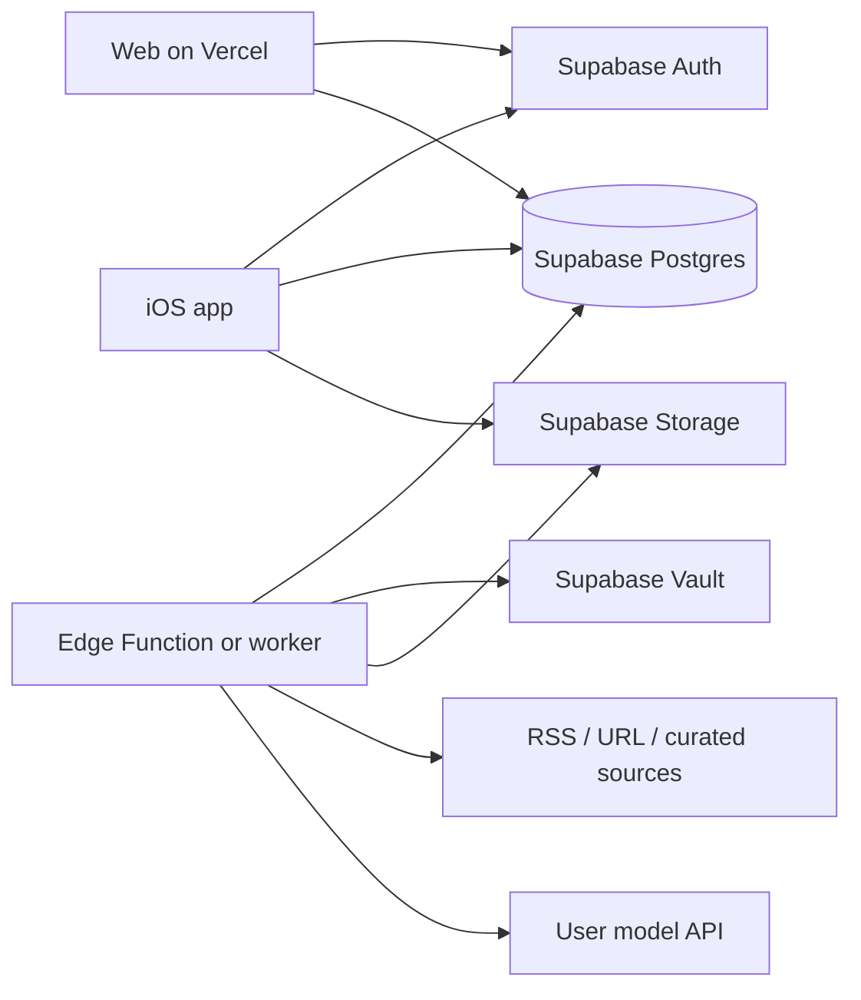

# 晨读产品架构

晨读是阅读、批注、笔记和 TTS 的载体。内容和模型都由用户自己决定：源、选题、节选长度、批注方式、用哪家模型、什么声音、何时推送。App 不绑定某一套课文或某一个 AI。

本文锁定边界和数据模型，不写实现。iOS 渲染、离线缓存、播放器保持现状，只换数据来源。

## 1. 现状

| 部分 | 现在 |
|---|---|
| 网站 | `https://chendu-english.vercel.app/`，Vercel 静态站。首页是往期列表，一期是 `issues/YYYY-MM-DD/` 的 HTML。音频是同目录的 `audio.mp3` / `audio-slow.mp3`。 |
| 数据 | 构建时写进页面。`data.json` 和索引 JSON 未公开（404）。可选的 `issues.json` + `issues/<date>/issue.json` 与 iOS 的 `Issue` 模型同形，尚未部署。 |
| iOS | SwiftUI，个人安装。优先拉 JSON，失败则解析 HTML。笔记在本机 SwiftData，锚点是 `paragraphIndex` + UTF-16 `start`/`length` + `quote`。没有账号，没有同步。 |
| 生成 | 人工：选一篇美股或 AI 报道，写中文批注、复习词、句型，TTS 出两档 mp3，早上约 7:51（北京时间）发布。 |

一期的内容形状已经稳定，后面的表按它拆，避免再发明一套字段：`title` / `zhTitle` / `byline` / `lead`、正文 `blocks`（`para` 或 `gap`，`segments[].text` + `note`）、`annotations`（`n`、`kind` = vocab/grammar/idiom、`head`、`body`）、`words`、`patterns`、`podcast`、`credit`、两条音频。

## 2. 设计原则：App 是载体，内容和 AI 都是用户自己的

晨读提供阅读器、批注呈现、笔记、TTS 播放、定时和同步。它不提供课文，也不提供模型。

- 读什么：用户的源、主题和轮换规则。精选目录只是可选项，不是默认课程。
- 谁来写批注、谁来朗读：用户自己的 provider、模型和 key，按任务分开。
- 写成什么样：深度、批注类型、学习者水平、解释语言、节选长度、复习词数量，以及可编辑的 prompt。
- 平台只设安全边界：版权节选上限、密钥不回传、RLS、生成失败不拿旧文充数。

注册时写入一套版本化的默认配置，用户之后改的每一项都盖过默认。Job 开跑时读当时的配置，并把用过的那一版记在这期上。事后改设置不影响已生成的期。

### 用户可配置项

| 项 | 存在 | 默认 |
|---|---|---|
| 内容源、启用、优先级 | `subscriptions` | 无订阅 |
| 主题过滤、轮换 | `generation_profiles.rotation` | `round_robin`，不限主题 |
| 选文 / 批注 / TTS 各自的 provider、key、模型；TTS 另有 `voice`、是否生成慢速 | `generation_profiles.tasks` | 空。缺 key 的任务不生成 |
| 批注深度 `light` · `standard` · `deep`；类型 vocab / grammar / idiom 开关 | `generation_profiles` | `standard`，三类都开 |
| 学习者水平 | `learner_level` | `B1`（CEFR，`A2`–`C2`） |
| 解释语言 | `explanation_lang` | `zh-CN` |
| 节选词数 | `excerpt_words` | 400，且不超过版权上限 |
| 时区、推送时刻、是否推送 | `user_settings` | `Asia/Shanghai`，`08:00`，推送关 |
| 复习：词条数、是否标音、句型条数 | `generation_profiles` | 12 词、标音、4 个句型 |
| 界面：主题、字号、正文字体、栏目标题是否用手写体 | `user_settings` | 纸色、系统字号、衬线正文、栏目标题用手写体 |
| 笔记同步开关、导出格式 | `user_settings` | 同步开；导出 Markdown |

界面项两端都读 `user_settings`，阅读器本地仍可临时放大字号。导出是客户端动作（Markdown / 原有笔记格式），不另建表。

### Prompt

`prompt_templates` 按任务分条：`select`、`annotate`、`vocab`、`patterns`。`owner_id` 为空的是平台默认，带 `version`。用户编辑时复制出自己的行（`owner_id`、`based_on_id`、`based_on_version`），不改平台行。新版本默认不覆盖已有的用户副本；用户可把某条重置回当前默认。TTS 不走文本模板，只走 `tasks.tts` 里的 voice 和模型。

## 3. 目标架构

- **Supabase**：Postgres、Auth、Storage、RLS。Auth 提供 Sign in with Apple 和邮箱（magic link 或密码）。音频只进 Storage，不进 Git。
- **Web（Vercel）**：登录、选源、订阅、看自己的往期、阅读器、笔记、key 与费用。官方静态往期在迁移完成前继续能打开。
- **iOS**：登录后用 Supabase 客户端读自己的期、写笔记、下音频。生成不在端上跑。
- **Job**：按用户时区入队。Worker 取明文 key、抓源、调用模型、写期、上传 mp3。客户端永远拿不到明文 key。

信任边界：浏览器和 App 是不可信的。它们可以提交 key、触发「今天生成一期」、读写自己的笔记。它们不能读取 `vault` 里的 secret，不能改别人的行，不能直接把抓到的全文标成公开。

## 4. 内容源与订阅

源分两类，订阅是用户和源之间的关系。

- **用户自建源**：`owner_id` 是该用户。`kind` 为 `rss` 或 `url`（单篇文章或栏目页）。
- **精选源**：`owner_id` 为空，`kind = curated`。开放许可或我们有权转载节选的源，出现在目录里，用户订阅后才进入他的生成。

一个人一天默认生成 **一期**。选哪一篇由 `generation_profiles.rotation` 决定（轮换或按 `priority`），并跳过已经用过的 `content_hash`。选不中就记失败原因，不拿旧文充数。

## 5. BYOK

`provider_keys` 只存指针和提示，不存明文。

1. 客户端调用 RPC `save_provider_key(provider, label, secret)`。
2. 函数用 `vault.create_secret` 写入 Supabase Vault，把返回的 `vault_secret_id` 和 `key_hint`（末四位）记入 `provider_keys`。参数 `secret` 不进日志。
3. 客户端查询自己的 key 时只能看到 `provider`、`label`、`key_hint`、`created_at`、`revoked_at`。RLS 不授予对 `vault.decrypted_secrets` 的权限。
4. Job 用 service role 在进程内解密，调用 OpenAI / Anthropic / xAI 等，调用结束即丢弃。失败响应里的 key 片段要打掉再写入 `jobs.last_error`。
5. 撤销是 `revoked_at = now()` 并删除对应 vault secret。进行中的 job 看到 revoked 就停止，不重试。

支持的 provider 用一张代码内的表描述：base URL、各任务可用的默认模型、TTS 是否另有 endpoint、价格（用于估算，不向用户收款）。用户在 `tasks` 里按任务覆盖模型和 key。v1 不代理、不垫付，费用发生在用户自己的账号上。

## 6. 数据模型

主键除注明外都是 `uuid`，时间都是 `timestamptz`。`user_id` 引用 `auth.users`。

### profiles

注册触发器从 `auth.users` 插入一行。

| 列 | 说明 |
|---|---|
| `id` | = `auth.users.id` |
| `display_name` | |

偏好不放这里。时区、推送和界面在 `user_settings`，生成在 `generation_profiles`。注册触发器同时插入这两行的默认值。

### user_settings

主键 `user_id`。`timezone`、`delivery_time`、`push_enabled`、`theme`、`font_scale`、`body_font`（`serif` · `system`）、`handwriting_headings`、`sync_notes`。见第 2 节的默认值。

### generation_profiles

v1 每人一行 `is_active`。列：`name`、`rotation`（jsonb）、`excerpt_words`、`learner_level`、`explanation_lang`、`annotation_depth`、`annotation_kinds`（text[]）、`vocab_count`、`include_ipa`、`pattern_count`、`tasks`（jsonb）。

`tasks` 的形状：`select`、`annotate`、`vocab`、`patterns` 各有 `provider_key_id`、`model`、`prompt_template_id`；`tts` 有 `provider_key_id`、`model`、`voice`、`slow`（bool）。未填的文本任务沿用 `annotate` 的 key 和模型，prompt 沿用该任务的当前平台默认。

### prompt_templates

| 列 | 说明 |
|---|---|
| `owner_id` | 空 = 平台默认，不可由用户修改 |
| `task` | `select` · `annotate` · `vocab` · `patterns` |
| `version` | 平台行单调增加；用户行固定为复制时的版本 |
| `body` | 模板正文，占位符由 job 填充（节选、水平、语言、条数） |
| `based_on_id`、`based_on_version` | 仅用户行 |

唯一：平台默认 `(task, version)`；用户同时只有一条启用的 `(owner_id, task)`。

### sources

| 列 | 说明 |
|---|---|
| `owner_id` | 空 = 精选目录 |
| `kind` | `rss` · `url` · `curated` |
| `title`、`url` | |
| `topic` | `stocks` · `ai` · `general`，可空 |
| `license` | `all-rights-reserved` · `cc-by` · `cc-by-sa` · `public-domain` 等 |
| `config` | jsonb：RSS 条目数、正文选择器、语言 |
| `enabled` | |

### subscriptions

主键 `(user_id, source_id)`。

| 列 | 说明 |
|---|---|
| `enabled` | |
| `priority` | int，大者优先 |
| `created_at` | |

### articles

一次抓取的原文，只属于触发这次抓取的用户。不进入任何公开列表。

| 列 | 说明 |
|---|---|
| `user_id`、`source_id` | |
| `external_url` | 原文链接，阅读器必须展示 |
| `title`、`author`、`published_at` | |
| `raw_text` | 抓到的正文，UI 不整篇展示 |
| `excerpt` | 实际拿去精读的节选 |
| `word_count` | 节选词数 |
| `content_hash` | 去重 |
| `license_snapshot` | 抓取当时源上的 license |
| `fetched_at` | |

### issues

一天一期：唯一约束 `(user_id, issue_date)`。

| 列 | 说明 |
|---|---|
| `article_id` | |
| `issue_date` | `date` |
| `topic`、`topic_label` | |
| `title`、`zh_title`、`byline`、`lead` | 与现在的 `Issue` 相同 |
| `blocks` | jsonb，与现在的 `ArticleBlock` 相同 |
| `credit`、`podcast` | jsonb，可空 |
| `status` | `ready` · `failed` |
| `config_snapshot` | jsonb。开跑时冻结的 profile、每个任务的 provider / model / voice、prompt 的 id 和 version、节选词数。不含 key |
| `created_at` | |

### annotations / vocab / patterns

都挂 `issue_id`，随 issue 删除。

`annotations`：`n`、`kind`、`tag`、`head`、`body`、`paragraph_index`、`start_utf16`、`length_utf16`。`blocks` 里的 `note` 数字与 `n` 对应。`tilt` 不再作为内容字段。

`vocab`：`position`、`word`、`ipa`、`meaning`、`example`。

`patterns`：`position`、`pattern`、`pattern_zh`、`source_sentence`、`model_sentence`、`model_zh`。

### audio_assets

| 列 | 说明 |
|---|---|
| `issue_id`、`kind` | `normal` · `slow`，唯一 `(issue_id, kind)` |
| `storage_path` | `audio/{user_id}/{issue_id}/{kind}.mp3` |
| `duration_sec`、`voice`、`byte_size` | |

桶是私有的。Storage policy：路径第一段等于 `auth.uid()` 才可 `select`。写入只给 service role。

### user_notes

id 由客户端生成，便于离线插入。

| 列 | 说明 |
|---|---|
| `user_id`、`issue_id` | |
| `paragraph_index`、`start_utf16`、`length_utf16`、`quote` | 与现在的 `UserNote` 相同 |
| `body` | 笔记正文 |
| `created_at`、`updated_at`、`deleted_at` | 删除是墓碑，不物理删除，直到同步完成 |
| `origin_device` | 可空，只用于调试 |

### reading_progress

主键 `(user_id, issue_id)`。`paragraph_index`、`completed`、`updated_at`。

### provider_keys

| 列 | 说明 |
|---|---|
| `user_id`、`provider` | 同一 provider 可有多把，一把 `is_default` |
| `label`、`key_hint` | |
| `vault_secret_id` | 客户端的 `select` 策略排除这一列（视图，见下） |
| `created_at`、`revoked_at` | |

对外只暴露视图 `provider_keys_public`（不含 `vault_secret_id`）。表本身不对 `authenticated` 授权。

### jobs

| 列 | 说明 |
|---|---|
| `user_id`、`kind` | v1 只有 `generate_issue` |
| `status` | `queued` · `running` · `succeeded` · `failed` · `cancelled` |
| `run_at` | 下次可执行时间 |
| `attempts`、`max_attempts` | 默认 3 |
| `locked_at`、`locked_by` | |
| `last_error` | 已脱敏 |
| `provider`、`model` | |
| `config_snapshot` | 与写入 issue 的是同一份 |
| `input_tokens`、`output_tokens`、`audio_chars`、`cost_usd` | 估算费用，给用户看。按任务拆在 snapshot 里，这里是合计 |
| `issue_id` | 成功后回填 |
| `created_at`、`finished_at` | |

费用页就是 `select` 自己的 jobs。不另建账本。

## 7. RLS

`authenticated` 角色。所有策略都先要求 `auth.uid() = user_id`（sources 的精选目录另说）。

| 表 | select | insert | update | delete |
|---|---|---|---|---|
| `profiles` | 自己 | 触发器 | 自己，且不能改 `id` | 无 |
| `user_settings`、`generation_profiles` | 自己 | 触发器 | 自己 | 无（v1 不删，只改） |
| `prompt_templates` | `owner_id` 为空，或是自己 | 自己，`owner_id` 必须是自己 | 仅自己的行 | 仅自己的行 |
| `sources` | 自己拥有的，或 `owner_id is null` 的精选 | 自己，`owner_id` 必须是自己 | 仅自己拥有的 | 仅自己拥有的 |
| `subscriptions` | 自己 | 自己；`source_id` 必须是自己可见的源 | 自己 | 自己 |
| `articles`、`issues`、`annotations`、`vocab`、`patterns`、`audio_assets` | 自己 | 无（service role） | 无 | 无 |
| `user_notes` | 自己 | 自己，`user_id` 固定为 `auth.uid()` | 自己 | 不允许物理删除；更新 `deleted_at` |
| `reading_progress` | 自己 | 自己 | 自己 | 自己 |
| `jobs` | 自己 | 无（走 RPC） | 无 | 无 |
| `provider_keys_public` | 自己 | 无（走 RPC） | 无 | 无 |

用户「删除一期」v1 不做硬删除。需要时加 `issues.hidden_at`，select 政策排除它，音频仍留在桶里直到单独的清理 job。

Service role 只出现在 Edge Function / worker 的环境变量里，不进客户端。

## 8. API

日常读写走 PostgREST，不另做一层 BFF。

客户端直接用的：

- `profiles`、`user_settings`、`generation_profiles`、`prompt_templates`（平台默认 + 自己的）、`sources`、`subscriptions`、`issues`（含嵌套 `annotations`、`vocab`、`patterns`、`audio_assets`）、`user_notes`、`reading_progress`、`jobs`、`provider_keys_public`。
- issues 列表按 `issue_date desc`。iOS 把一行映射成现有的 `Issue`，阅读器不用改。
- 音频用 Storage 的短时 signed URL 下载，再落入现在的离线缓存。

RPC（`security definer`，内部核对 `auth.uid()`）：

| 函数 | 作用 |
|---|---|
| `save_provider_key(provider, label, secret)` | 写入 Vault，返回不含 secret 的行 |
| `revoke_provider_key(id)` | 标记撤销并删 secret |
| `enqueue_issue(for_date date default null)` | 为「今天」（按 `user_settings.timezone`）插入一条 `queued` job。当天已有 `queued`/`running`/`succeeded` 则直接返回那一行 |
| `cancel_job(id)` | 仅 `queued` 可取消 |

Edge Function `run-jobs`：只接受 service role 或 cron 密钥。逻辑见下一节。不给用户 JWT 调用它。

Web 与 iOS 不共享另一套 REST。官方静态站的 `issues.json` 在迁移期仍是未登录的只读入口，不是新产品的 API。

## 9. 生成流水线

`pg_cron` 每分钟调用 `run-jobs`。函数做两件事：

1. **入队**。找出「当地时间的小时分钟等于 `user_settings.delivery_time`，且该 `issue_date` 还没有成功或在跑的 job」的用户，插入 `jobs`。`push_enabled` 只决定成功后要不要推送，不决定是否生成。错过窗口（函数没跑）时，同一天内下一次跑仍会补入队，直到当天结束。
2. **领取**。`update ... where id in (select id from jobs where status = 'queued' and run_at <= now() order by run_at for update skip locked limit 5) set status = 'running', locked_at = now(), attempts = attempts + 1`。

单次 job：

1. 读该用户的 `user_settings` 和 `is_active` 的 `generation_profiles`，解析每个任务的 key、模型、voice 和 prompt（用户副本，否则该任务当前平台默认版本）。冻结进 `jobs.config_snapshot`。选文或批注缺 key：失败且不重试，`last_error = 'no_provider_key'`。TTS 缺 key 则这期没有音频，文本仍可成功。
2. 按 snapshot 里的轮换规则拉订阅源。网络失败可重试。
3. 用选文任务的模型和 prompt 定一篇。节选长度取 `min(excerpt_words, 该源的版权上限)`。再用批注、复习词、句型各自的 prompt 和 `learner_level`、`explanation_lang`、深度、类型、条数生成。输出用 JSON schema 校验，对不上就重试。
4. 若配置了 TTS：按 `voice` 合成，`slow = true` 时再出一档。上传 Storage，写 `audio_assets`。
5. 同一事务写入 `articles`、`issues`（带同一份 `config_snapshot`）及子表，`jobs.status = succeeded`。之后用户改 profile 或 prompt，不回写这一期。

重试：`attempts < max_attempts` 时把状态改回 `queued`，`run_at = now() + interval`（2 分钟、10 分钟、30 分钟）。429 走同一退避。401/403 把 key 标为需要重新保存，不再重试。

限额（v1，写在配置里）：每用户每天最多 1 期成功生成；每用户同时最多 1 个 `running`；单 job 的 prompt 输入上限（例如 8k token 的节选）。超限的 `enqueue_issue` 返回已有 job，不新建。

`cost_usd` 用代码里的价目表估算：文本 token + 音频字符。设置页按月汇总。这是可见性，不是账单。

Edge Function 的时长不够跑完 TTS 时，`run-jobs` 只负责入队和领取，真正的生成改到独立 worker（见未决问题）。表和状态机不变。

## 10. 笔记同步

iOS 仍以本地 SwiftData 为第一存储，有网再同步。Web 在线写，离线时用本地队列，同一套规则。

锚点沿用现在的字段：`paragraph_index`、UTF-16 `start`/`length`、`quote`。打开时若切片对不上 `quote`，就在该段里查找 `quote`，找不到则标为脱离原文，笔记仍保留。

同步：

- 每行有客户端生成的 `id`。推送本地 `updated_at` 比游标新的行（含 `deleted_at` 非空的墓碑）。拉取服务端更新的行。
- 同一 `id` 双方都改过：比较 `updated_at`，**后写覆盖**（last-write-wins）。时钟取客户端写入时的本地时间，服务端不改写 `updated_at`，避免慢网把旧稿标新。
- 墓碑优先于更早的正文更新。拉取到墓碑后本地删除。
- 不合并同一条笔记的两段文字。若需要留下两边，那是产品决定（见未决问题），v1 不做得更复杂。
- `reading_progress` 同样 LWW。段落号取较大的 `updated_at` 所对应的值，不取 max(paragraph)。

冲突窗口只在两台设备同时编辑同一条笔记时出现。一期的批注是生成结果，不是笔记，不参与这套同步。

## 11. 版权

生成结果是用户的私人学习材料，不是一份公开出版物。

- 抓取的正文按用户存放。RLS 保证别人读不到。不做「社区精读」分享。
- 保留版权的源：平台上限 **500 个英文词**。用户的 `excerpt_words` 可以更短，不能更长。优先开篇加一个完整段落。阅读器展示原文链接、作者、媒体名，以及「节选用于个人学习」。
- `license` 为 CC 或 public domain 的源可以按该源单独的上限放宽，并在 `credit` 里保留许可和署名。用户的 `excerpt_words` 仍然生效。
- 音频是这段节选的 TTS，不是原媒体的录音。路径私有。
- 模型写的中文批注、复习词、句型是生成内容，可以随用户的期保存。
- 官方静态站上已经公开的历史期维持现状（个人学习站、链到原文）。它们不导入成「所有用户共享的全文库」。新产品里若要保留「晨读精选」，用精选源重新生成，或只迁移元数据和原文链接。

## 12. 迁移

每一期都可以单独上线，前一阶段的静态站和本地笔记继续可用。

| 阶段 | 做什么 | 用户能感知的变化 |
|---|---|---|
| 0（现在） | 静态 HTML + iOS 解析页面或 `issue.json` + 本地笔记 | 无 |
| 1 | 建 Supabase 项目、表、RLS、Auth、Vault、私有音频桶。不接生成。 | 无 |
| 2 | iOS 登录。官方期仍从现有网站读。增加一次本地笔记导出：把 SwiftData 行 POST 到 `user_notes`，`issue_id` 先用 `issue_date` 对应到导入的占位 issue。 | 换机可恢复笔记 |
| 3 | Web 阅读器读 Supabase。笔记按第 10 节同步。静态站保留为未登录的历史档案。 | 手机和浏览器看到同一批笔记 |
| 4 | 上 BYOK、订阅和 cron。新期只写进该用户的 `issues`。静态站的每日发布可以继续，当作未登录档案，直到精选源替代它。 | 用户开始收到自己的期 |
| 5 | iOS 的 HTML 解析降为档案兜底，然后删除。每日手写发布停止。 | 只剩账号内的期 |

占位 issue：阶段 2 为每个已有 `YYYY-MM-DD` 建一行 `issues`，`user_id` 空不合适（RLS 要求拥有者）。改为每个用户在导出时复制一份**元数据**（title、date、原文 URL），正文仍从静态站拉，不把现有 HTML 全文复制进所有人的 `articles`。

本地笔记在导出后仍留在 SwiftData，作为该设备的离线副本，不在导出成功时清空。

## 13. 未决问题

1. **Worker 放哪。** TTS 加两次模型调用可能超过 Edge Function 时限。状态机按「独立 worker 也能跑」来设计；是否第一天就用独立进程，等一次真实生成的耗时再定。
2. **一天一期还是一源一期。** v1 按一天一期，轮换方式由用户的 `rotation` 决定。多源同时各出一期要另加配额，表结构不用改。
3. **「晨读精选」是否默认订阅。** 新用户可以有一份官方源，也可以从空白开始。这影响阶段 4 能否关掉手写发布。
4. **笔记冲突要不要留两份。** v1 写的是后写覆盖。如果试用时误删明显，再改成保留双方并标冲突。
5. **登录方式的组合。** Sign in with Apple 在上架 App Store 时是必须的（若还有别的第三方登录）。邮箱是否同时做密码和 magic link，未定。
6. **Vault 的托管前提。** 方案假设用 Supabase 托管版的 Vault。自建时改用应用层信封加密（KMS 或 age），表结构只保留 `vault_secret_id` 这一个指针，可以替换实现。
7. **版权上限的具体数字。** 500 词是和现在的期对齐的平台天花板，用户在其下自选。这不是法律意见。上线公开注册前需要人对主要源的 ToS 看一遍。
8. **Web 栈。** 现有站点是构建出来的静态 HTML。新产品的 Web 用单独的 Vercel 项目（建议有服务端会话的框架），还是把登录页嵌进现有仓库，未定。静态档案和登录后的阅读器不要混成一次发布。
